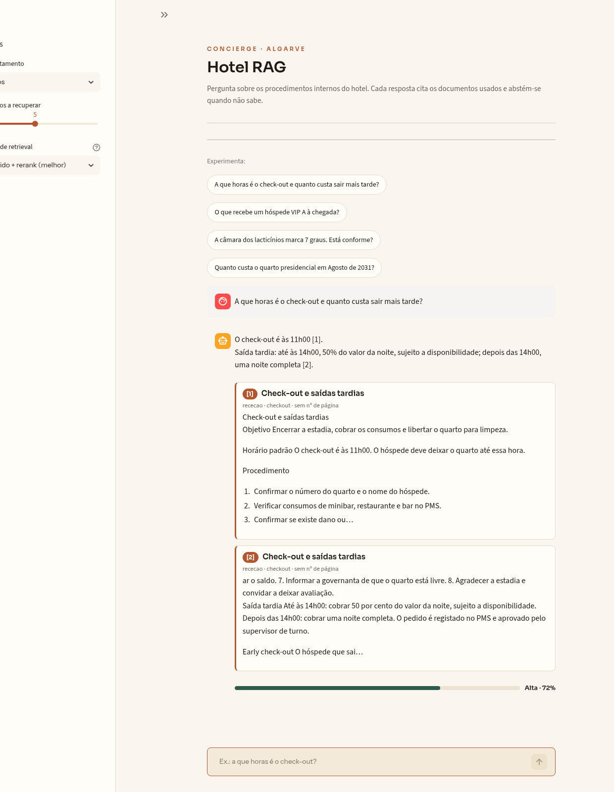
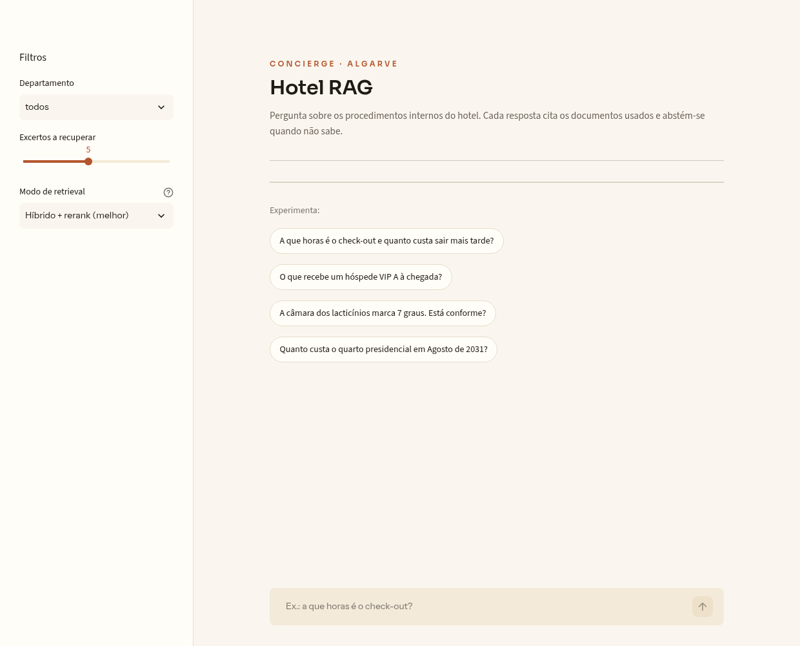
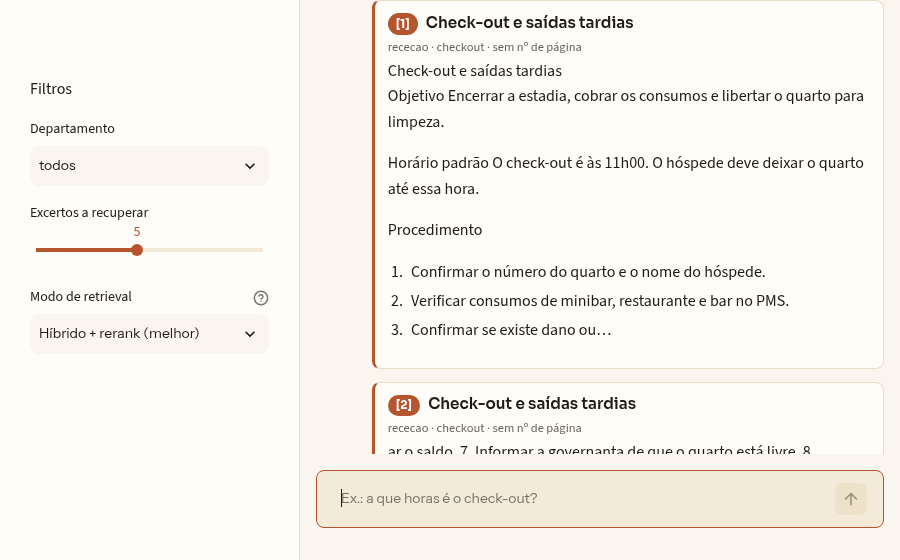

# Hotel RAG — Algarve

Sistema de **Retrieval-Augmented Generation** sobre os procedimentos operacionais
de um hotel fictício do Algarve: receção, F&B, copa/cozinha, estacionamento e
manutenção. Responde em PT-PT (e em inglês), **cita o documento e o excerto** que
sustenta cada resposta e **abstém-se** quando a documentação não contém a
resposta.

> Este repositório é uma peça de portfólio. O corpus é ficcional, mas a
> arquitetura, os testes e a avaliação são reais.

## UI

Interface Streamlit com tema editorial claro: chips de perguntas de exemplo,
cartões de citação por SOP e um medidor de confiança na resposta (verde para
"Alta", terracota para "Média", âmbar para "Baixa"); quando não há evidência
suficiente, a UI mostra o cartão de abstenção em vez de adivinhar.



<details>
<summary>Ecrã inicial e excerto citado</summary>





</details>

## O que este projeto demonstra

- **RAG completo e avaliado**: ingestão → chunking com offsets → embeddings
  locais → retrieval híbrido → reranking → geração com citações → abstenção.
- **Comparação honesta de configurações**: `vector` vs. `hybrid` vs.
  `hybrid_rerank`, com recall@k, MRR e nDCG@k sobre 40 perguntas base e um
  conjunto difícil de 22 paráfrases. Os três modos são selecionáveis na UI e na
  API.
- **Citações rastreáveis**: cada citação aponta para `doc_id`, título,
  departamento e o excerto exato (com offsets de caracteres).
- **Abstenção em vez de alucinação**: limiar de score + marcador explícito
  `ABSTAIN` no prompt.
- **Engenharia reproduzível**: Docker multi-stage, testes canónicos no container,
  CI com gate de qualidade de retrieval.

## Arquitetura

```text
data/corpus/*.md            (35 documentos, frontmatter YAML)
        │
        ├── corpus.py       frontmatter + versões (v1/v2, só a mais recente)
        ├── chunking.py     janelas de 800 chars, overlap 120, offsets exatos
        │
        ├── embeddings.py   BAAI/bge-m3 (local, lazy load)
        ├── store.py        Qdrant (in-memory nos testes)
        ├── bm25.py         BM25Plus + Reciprocal Rank Fusion
        ├── rerank.py       bge-reranker-v2-m3 (scores normalizados)
        └── retrieval.py    modos: vector | hybrid | hybrid_rerank (selecionáveis)
                │
        generation.py       prompt numerado [1..n], citações, ABSTAIN
                │
        pipeline.py  ──►  api/main.py (FastAPI)  ──►  ui/app.py (Streamlit)
                │
        eval/               golden set + métricas + gate de CI
```

## Quickstart (Docker — canónico)

```bash
cp .env.example .env          # preencher LLM_BASE_URL, LLM_API_KEY, LLM_MODEL
docker compose up -d qdrant   # vector store
make index                    # embeddar o corpus para o Qdrant
make up                       # API :8000 + UI :8501
```

- UI: <http://localhost:8501>
- API/OpenAPI: <http://localhost:8000/docs> (inclui `/sources` com os documentos indexados)
- Qdrant: <http://localhost:6333/dashboard>

Configuração do LLM: `config/llm.yaml` guarda apenas os valores não-secretos
(`base_url`, `model`, `temperature`, `timeout_seconds`). Variáveis de ambiente e
`.env` têm precedência sobre o ficheiro. A chave (`LLM_API_KEY`) só existe no
ambiente; o `config/llm.yaml` rejeita `api_key` explicitamente para evitar
segredos versionados.

Testes (ambiente canónico):

```bash
make test     # docker compose run --rm dev pytest (inclui integração)
make lint
```

## Loop rápido local (opcional)

```bash
uv sync --all-extras
uv run pytest
uv run ruff check . && uv run ruff format --check .
```

## Avaliação

```bash
make eval       # 40 perguntas base; escreve results/latest.json
make eval-hard  # 22 perguntas difíceis; escreve results/hard.json
uv run python scripts/check_eval_threshold.py results/latest.json
```

O golden set (`data/golden/golden_set.jsonl`) cobre os cinco departamentos, inclui
perguntas cuja resposta só existe na versão 2 do check-in, perguntas de tabela
(temperaturas, alergénios) e cinco perguntas em inglês.

### Resultados medidos

`BAAI/bge-m3` + `BAAI/bge-reranker-v2-m3`, 40 perguntas (35 PT, 5 EN), `k = 5`,
índice com 35 documentos. Relatório completo em `results/latest.json`.

| Configuração | recall@5 | MRR | nDCG@5 |
|---|---|---|---|
| `vector` | 1.000 | 0.988 | 0.991 |
| `hybrid` | 1.000 | 0.983 | 0.988 |
| `hybrid_rerank` | **1.000** | **1.000** | **1.000** |

**Como ler estes números.** O recall satura porque o corpus é pequeno (35
documentos) e as perguntas foram redigidas a partir dos próprios documentos: com
5 chunks recuperados, o documento certo entra quase sempre. O sinal útil está no
**ranking**: o reranker coloca o documento relevante em primeiro lugar em todas
as 40 perguntas (MRR = 1.0), enquanto o híbrido sem reranker é ligeiramente
*pior* que o vetor puro (0.983 vs. 0.988) — o BM25 promove correspondências de
palavras comuns em perguntas parafraseadas, e o RRF mistura esse ruído. É um
resultado contraintuitivo e está reportado como tal: a conclusão não é "híbrido
é sempre melhor", é "o reranker resolve a ordem final; o híbrido precisa de um
benchmark mais difícil para justificar o custo".

Um benchmark mais exigente (perguntas adversariais, paráfrases coloquiais,
documentos distratores) é o próximo passo para tornar o recall discriminativo.

### Benchmark difícil (22 perguntas)

`data/golden/golden_set_hard.jsonl` foi escrito **sem reutilizar o vocabulário
dos documentos**: paráfrases coloquiais, uma pergunta que exige dois documentos
(check-in + check-out) e cinco em inglês. Corre-se com `make eval-hard`
(relatório em `results/hard.json`).

| Configuração | recall@5 | MRR | nDCG@5 |
|---|---|---|---|
| `vector` | 1.000 | 1.000 | 1.000 |
| `hybrid` | 0.909 | 0.845 | 0.860 |
| `hybrid_rerank` | **1.000** | **1.000** | **1.000** |

O híbrido sem reranker falha duas perguntas — as duas mais curtas e mais
distantes do texto original:

- *"Deixei uma camisola no quarto. Quanto tempo a guardam?"* → devolve
  `checkout`, `reclamacoes`, `queixas-fnb`, `plano-limpeza`; o documento certo
  (`objetos-perdidos`) não entra no top-5.
- *"How long can a guest keep an electric car plugged in, and is there a fee?"*
  → devolve `checkin`, `vip`, `overbooking`, `checkout`; o BM25 não tem sinal
  útil em inglês e o RRF dilui o resultado vetorial.

O reranker recupera ambas e mantém 1.000. A conclusão honesta: **o híbrido só
compensa com rerank**; sozinho, o BM25 acrescenta ruído em perguntas
parafraseadas. E 22 perguntas num corpus de 35 documentos continuam a não
distinguir `vector` de `hybrid_rerank` — para isso seria preciso um corpus maior,
perguntas escritas por terceiros e documentos distratores.

**Metodologia.** Para cada pergunta, o retriever devolve 5 chunks; as métricas são
calculadas ao nível do `doc_id` (um documento relevante conta uma vez), com
deduplicação que preserva a primeira ocorrência. O gate de CI (`eval-gate`) falha
se `recall@k < 0.70`, `mrr < 0.60` ou `ndcg@k < 0.65`.

## Estrutura

```text
src/hotel_rag/        modelos, corpus, chunking, embeddings, store, bm25,
                      rerank, retrieval, generation, pipeline, config, llm
api/                  FastAPI (/health, /answer)
ui/                   Streamlit (cliente fino da API)
scripts/              build_index.py, check_eval_threshold.py, start_space.sh
data/corpus/          35 documentos markdown com frontmatter
data/golden/          golden sets JSONL (40 perguntas base + 22 difíceis)
results/              relatórios de avaliação (latest.json, hard.json)
tests/                unit (sem modelos) + integration (in-memory)
docs/decisions/       ADRs
docs/images/          capturas da UI usadas neste README
```

## Decisões de engenharia

- [ADR 0001 — Stack e limites](docs/decisions/0001-stack.md)
- [ADR 0002 — Retrieval híbrido, RRF e reranking](docs/decisions/0002-hybrid-retrieval.md)
- [ADR 0003 — Runtime Docker-first](docs/decisions/0003-docker-runtime.md)

## Limitações honestas

- **Corpus ficcional e pequeno (35 documentos):** serve para demonstrar o
  pipeline, não para afirmar qualidade em produção. Um corpus real teria
  centenas de milhares de chunks e exigiria indexação incremental.
- **Golden set escrito pelo autor do corpus:** há risco de viés; as perguntas
  foram redigidas a partir dos documentos, não por um especialista independente.
- **Uma propriedade:** o campo `property_id` existe como gancho para multi-hotel,
  mas não é usado em filtros nesta versão.
- **Latência em CPU:** o reranker domina o tempo de resposta. A imagem de deploy
  é CPU-only (torch do índice `pytorch-cpu`), o que corta ~5 GB de wheels CUDA;
  para acelerar localmente, o profile `gpu` constrói um target com torch CUDA.
- **Sem demo pública alojada:** a demo corre localmente com `docker compose`. O
  código suporta Qdrant in-memory no arranque (`scripts/start_space.sh`), mas o
  free tier do Hugging Face já não cobre Docker Spaces.
- **Métricas de resposta (RAGAS):** não implementadas nesta versão. Exigem um
  modelo juiz e uma chave de LLM, o que tornaria a avaliação não determinística;
  as métricas de retrieval cobrem o que o CI consegue garantir offline. Ficam
  como trabalho futuro, com um golden set de contextos ao nível do chunk.

## Licença

MIT — ver [LICENSE](LICENSE).
